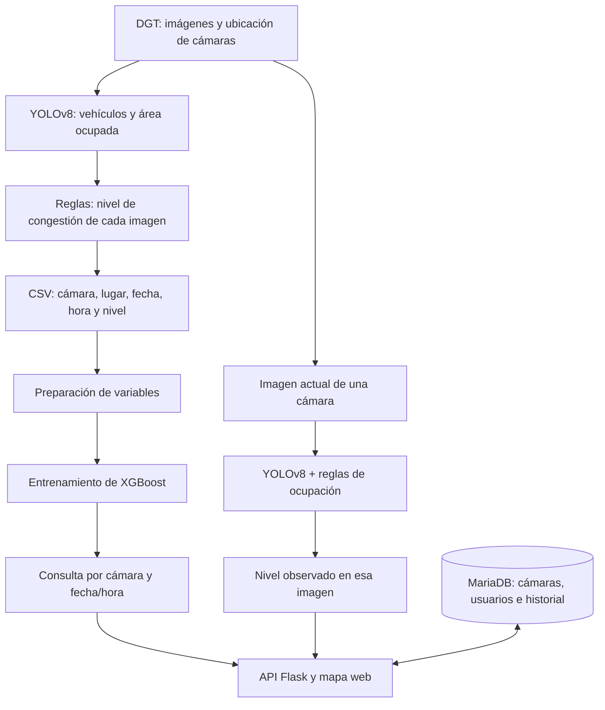

# MADRIVEE · Análisis de congestión en Madrid

**Proyecto universitario desarrollado en equipo.** Este repositorio es una copia personal del trabajo grupal. El [repositorio original](https://github.com/RickVicente/Proyecto-de-Computaci-n-I) permanece independiente.

MADRIVEE es un prototipo para explorar la congestión del tráfico a partir de cámaras públicas de la DGT. Permite ver las cámaras en un mapa, analizar la imagen de una cámara y consultar una estimación para una cámara y una fecha/hora. Estas dos consultas siguen caminos distintos, explicados más abajo.

> **English summary:** University team project that combines public traffic-camera data, computer vision and a congestion classifier with a Flask API, MariaDB and a web map.

## Cómo funciona, de un vistazo



El esquema tiene **dos salidas**. La rama de arriba explica cómo se preparó el modelo XGBoost. Después, ese modelo permite pedir una estimación para una fecha y hora. La rama de abajo analiza una imagen disponible en ese momento con YOLO. Ambas respuestas se muestran a través de la aplicación web, pero una no ejecuta automáticamente la otra.

## Del fotograma al modelo

1. **Recoger imágenes y datos de cámaras.** La DGT publica la ubicación de las cámaras y sus imágenes. El script [`descargar_imagenes.py`](CodigosPython/ML_analisis_transformacion/descargar_imagenes.py) consulta las cámaras seleccionadas y registra de cuál procede cada imagen, su carretera, ubicación y momento de captura.
2. **Medir lo que se ve.** YOLOv8 identifica vehículos y delimita la zona que ocupan en la imagen. El programa guarda el recuento y calcula qué parte de la imagen está ocupada. Con unos umbrales definidos en el código, asigna un nivel: **0 fluido**, **1 denso**, **2 atasco** o **3 muy congestionado**. Por ejemplo, una ocupación visual del 6 % se clasifica como nivel 1. Esta etiqueta procede de la regla de ocupación, no de XGBoost.
3. **Crear un conjunto de datos.** Cada observación queda en [`1. datasetCompleto.csv`](CodigosPython/datasets/1.%20datasetCompleto.csv): cámara, lugar, fecha, hora, recuentos y nivel calculado. [`transformacion_dataset.py`](CodigosPython/ML_analisis_transformacion/transformacion_dataset.py) convierte fecha, hora y carretera en variables numéricas y genera [`2. datasetNormalizado.csv`](CodigosPython/datasets/2.%20datasetNormalizado.csv).
4. **Entrenar XGBoost.** El script [`2. xgboost_training.py`](CodigosPython/ML_analisis_transformacion/2.%20xgboost_training.py) separa datos de entrenamiento y prueba y ajusta un clasificador de cuatro niveles. En este entrenamiento, XGBoost aprende la relación entre **cámara, ubicación, carretera y momento** y el nivel obtenido previamente. Los recuentos de vehículos se guardan en el CSV original, pero la transformación los elimina antes de entrenar XGBoost: **la imagen y los recuentos no son entradas directas de la predicción por fecha y hora**.

## Qué ocurre al usar la web

- **Ver una cámara en el mapa:** la interfaz pide a la API las ubicaciones guardadas en MariaDB y muestra las cámaras disponibles.
- **Analizar la imagen de una cámara:** la API descarga su imagen de la DGT, YOLO calcula la ocupación visual y las reglas devuelven uno de los cuatro niveles. Esta consulta usa la imagen disponible, no el clasificador XGBoost.
- **Consultar una fecha y hora:** la interfaz envía los datos de la cámara y el momento elegido a la API. XGBoost devuelve un nivel estimado a partir de las variables con las que fue entrenado. Esta consulta **no analiza una imagen futura ni observa el tráfico real de esa fecha**. La aplicación intenta guardar la consulta en MariaDB para el historial.

La diferencia es útil para interpretar el resultado: el análisis de imagen describe lo que detecta YOLO en un fotograma; la consulta por fecha y hora es una estimación basada en patrones del conjunto de datos. Ninguna de las dos debe interpretarse como una medición oficial del tráfico.

## Contenido del repositorio

| Ruta | Función |
| --- | --- |
| [`api.py`](api.py) | API Flask y conexión con base de datos, frontend y modelos. |
| [`init.sql`](init.sql) | Esquema SQL y ubicaciones de cámaras públicas de ejemplo. |
| [`CodigosPython/`](CodigosPython/) | Descarga, transformación, análisis de imágenes y entrenamiento. |
| [`ModelosIA/`](ModelosIA/) | Artefactos pequeños del clasificador y preprocesamiento. |
| Archivos `.html` | Inicio de sesión, registro, mapa y vistas de usuario/administración. |
| [`docker-compose.yml`](docker-compose.yml) | Arranque local de API y MariaDB. |

**El proyecto principal sí está incluido:** la web, la API, los scripts de análisis y entrenamiento, los conjuntos de datos y el modelo XGBoost ya entrenado con sus archivos de preprocesamiento. `init.sql` permite crear de nuevo la base de datos vacía con las ubicaciones de las cámaras.

Se han omitido las cuentas y contraseñas de usuarios reales, las imágenes descargadas y los vídeos de demostración. Tampoco se incluye `yolov8x-seg.pt`: es un peso preentrenado de YOLO de unos 144 MB, necesario para analizar imágenes. Ultralytics intenta descargarlo cuando se usa esa función por primera vez; para ejecutarla sin conexión hay que obtener el peso por separado. La contraseña de MariaDB y la clave de sesión de Flask se definen en un archivo `.env` local que no se publica.

## Probarlo en local

Requiere Docker y Docker Compose. Copia [`.env.example`](.env.example) a `.env` y asigna valores propios a las tres variables. Después:

```bash
docker compose up --build
```

La aplicación quedará disponible en `http://localhost:5000`. Puedes registrarte desde la interfaz. La visualización y descarga de imágenes necesitan acceso a los servicios públicos de la DGT. El análisis visual necesita `yolov8x-seg.pt`; al usar esa función, Ultralytics puede obtener el peso si está disponible en su origen oficial, o puedes situarlo en la raíz del proyecto para una ejecución local.

El proyecto es un **prototipo académico**. Antes de usarlo en producción habría que sustituir el hash SHA-256 de contraseñas por un algoritmo específico para contraseñas, reforzar la validación y los permisos de los endpoints, añadir pruebas automatizadas y revisar el tratamiento de los datos de las cámaras. Las modificaciones de esta copia se limitan a retirar datos privados, separar la configuración sensible y evitar algunos accesos no autorizados evidentes.

## Fuente de datos y alcance

Los metadatos e imágenes provienen de las cámaras públicas de la [Dirección General de Tráfico](https://www.dgt.es/). Las predicciones reflejan un ejercicio universitario y no deben utilizarse para decisiones de circulación en tiempo real.
