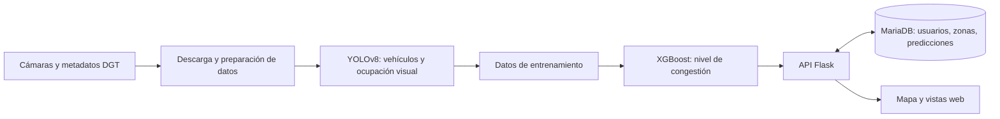

# MADRIVEE · Análisis de congestión en Madrid

**Proyecto universitario desarrollado en equipo.** Este repositorio es una copia personal del trabajo grupal. El [repositorio original](https://github.com/RickVicente/Proyecto-de-Computaci-n-I) permanece independiente.

MADRIVEE utiliza imágenes de cámaras públicas de la DGT para estimar el nivel de tráfico y mostrarlo en un mapa. El sistema también permite consultar una predicción para una cámara y una fecha/hora, y guardar un historial de esas consultas.

> **English summary:** University team project that combines public traffic-camera data, computer vision and a congestion classifier with a Flask API, MariaDB and a web map.

## Cómo funciona



Los cuatro niveles que muestra la aplicación son **fluido**, **denso**, **atasco** y **muy congestionado**. YOLO analiza las imágenes; XGBoost utiliza los datos preparados para clasificar la congestión. La API conecta esos módulos con la base de datos y la interfaz.

## Contenido del repositorio

| Ruta | Función |
| --- | --- |
| [`api.py`](api.py) | API Flask y conexión con base de datos, frontend y modelos. |
| [`init.sql`](init.sql) | Esquema SQL y ubicaciones de cámaras públicas de ejemplo. |
| [`CodigosPython/`](CodigosPython/) | Descarga, transformación, análisis de imágenes y entrenamiento. |
| [`ModelosIA/`](ModelosIA/) | Artefactos pequeños del clasificador y preprocesamiento. |
| Archivos `.html` | Inicio de sesión, registro, mapa y vistas de usuario/administración. |
| [`docker-compose.yml`](docker-compose.yml) | Arranque local de API y MariaDB. |

**El proyecto principal sí está incluido:** la web, la API, los scripts de análisis y entrenamiento, los conjuntos de datos y el modelo XGBoost ya entrenado con sus archivos de preprocesamiento. `init.sql` permite crear de nuevo la base de datos vacía con las ubicaciones de las cámaras.

Se han omitido las cuentas y contraseñas de usuarios reales, las imágenes descargadas y los vídeos de demostración. Tampoco se incluye `yolov8x-seg.pt`: es un peso preentrenado de YOLO de unos 144 MB, necesario para analizar imágenes. Ultralytics intenta descargarlo cuando se usa esa función por primera vez; para ejecutarla sin conexión hay que obtener el peso por separado. La contraseña de MariaDB y la clave de sesión de Flask se definen en un archivo `.env` local que no se publica.

## Probarlo en local

Requiere Docker y Docker Compose. Copia [`.env.example`](.env.example) a `.env` y asigna valores propios a las tres variables. Después:

```bash
docker compose up --build
```

La aplicación quedará disponible en `http://localhost:5000`. Puedes registrarte desde la interfaz. La visualización y descarga de imágenes necesitan acceso a los servicios públicos de la DGT. El análisis visual necesita `yolov8x-seg.pt`; al usar esa función, Ultralytics puede obtener el peso si está disponible en su origen oficial, o puedes situarlo en la raíz del proyecto para una ejecución local.

El proyecto es un **prototipo académico**. Antes de usarlo en producción habría que sustituir el hash SHA-256 de contraseñas por un algoritmo específico para contraseñas, reforzar la validación y los permisos de los endpoints, añadir pruebas automatizadas y revisar el tratamiento de los datos de las cámaras. Las modificaciones de esta copia se limitan a retirar datos privados, separar la configuración sensible y evitar algunos accesos no autorizados evidentes.

## Fuente de datos y alcance

Los metadatos e imágenes provienen de las cámaras públicas de la [Dirección General de Tráfico](https://www.dgt.es/). Las predicciones reflejan un ejercicio universitario y no deben utilizarse para decisiones de circulación en tiempo real.
